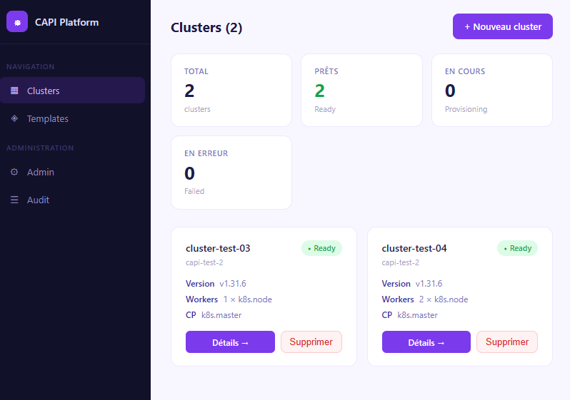
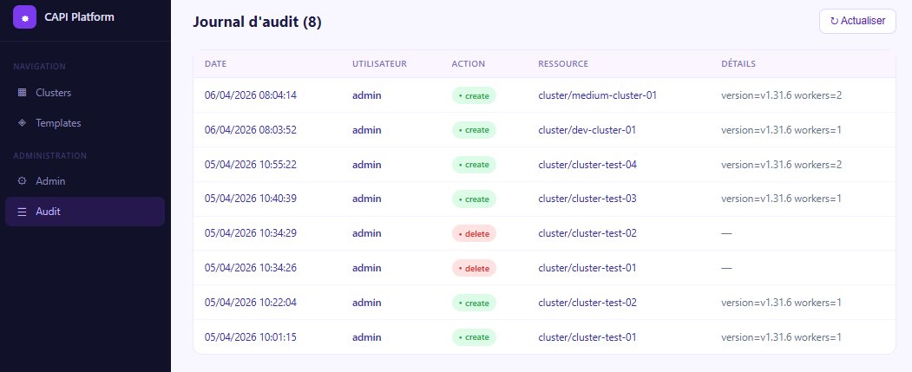
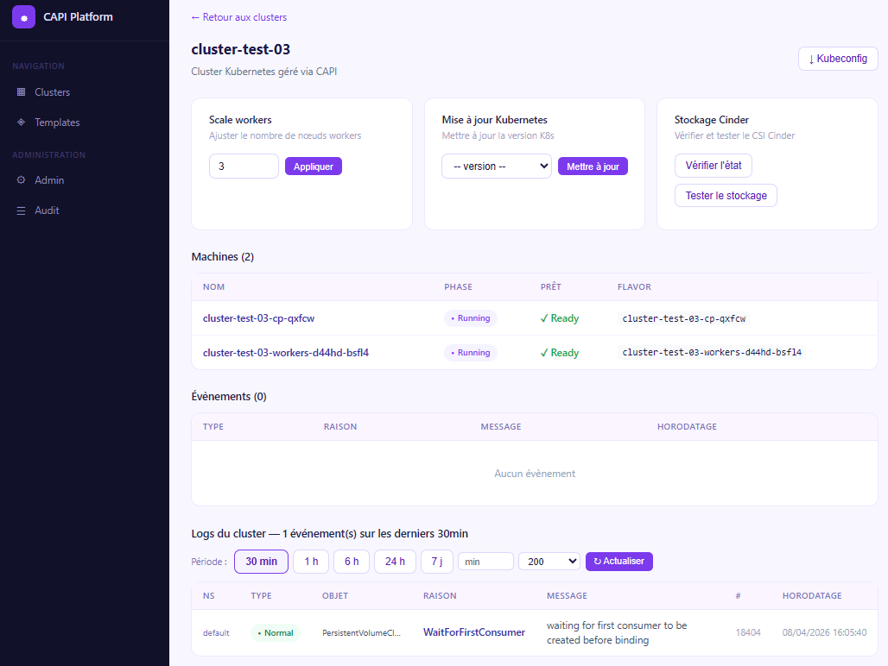
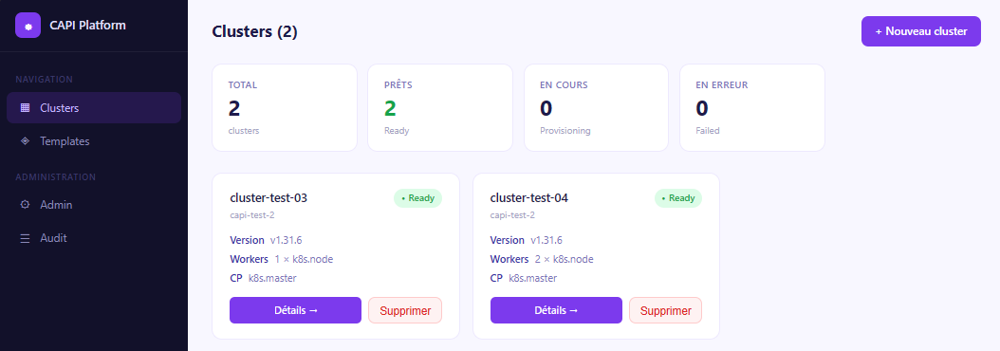
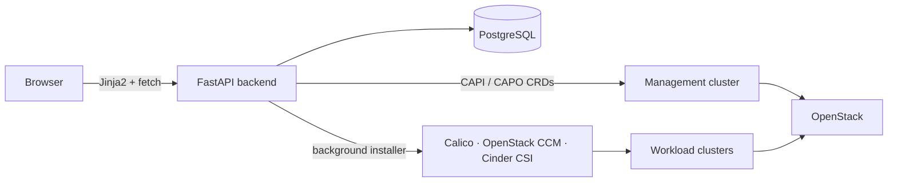

# CAPI Platform UI

**Self-service Kubernetes cluster provisioning on OpenStack — without writing YAML.**

[](https://github.com/GhostSN221/capi-platform-ui/actions/workflows/ci.yml)

CAPI Platform UI is a web control plane for [Cluster API](https://cluster-api.sigs.k8s.io/) (CAPI) and CAPO on OpenStack. It replaces the 7+ manifests normally needed for one cluster with a single form, then installs Calico, OpenStack CCM and Cinder CSI, and exposes the day-2 operations that usually require switching between `kubectl`, OpenStack and a wiki: scale, upgrade, logs, resource browsing and storage checks.

It was built for platform teams and managed-service providers who run one Kubernetes cluster per client and are tired of copy-pasting YAML.

---

## Why this exists

Provisioning a CAPI cluster by hand means writing (and keeping consistent) a Cluster, a KubeadmControlPlane, a MachineDeployment, an OpenStackCluster, a secret, and several addon manifests. One wrong `apiVersion` produces a cryptic 422, and every new client repeats the same copy-paste.

CAPI Platform UI turns that into a multi-tenant workflow:

- a form with validated CIDRs, flavours and Kubernetes versions;
- server-side guardrails so a bad CIDR cannot reach OpenStack;
- automatic post-install of Calico, CCM and Cinder CSI;
- audit logs, per-tenant namespaces and OpenStack credentials;
- day-2 actions from the same UI.

---

## Try the demo (no OpenStack, no Kubernetes, no credentials)

The demo runs a real FastAPI + PostgreSQL stack with deterministic data. It does **not** call OpenStack or Kubernetes, so it works on a laptop.

```bash
git clone https://github.com/GhostSN221/capi-platform-ui.git
cd capi-platform-ui/capi-platform
docker compose -f docker-compose.demo.yml up --build
```

Open <http://localhost:8001> and log in with:

```text
username: demo
password: demo
```

You can browse the dashboard, cluster details, machines, events, resource explorer, pod logs, templates, audit log and the CIDR validator. Creating a cluster runs the real validation path; scaling and deletion update the demo database.

> The demo is intentionally isolated in `backend/app/services/demo.py` and `DEMO_MODE=true`. It replaces infrastructure adapters only; the API, database models, auth, network validation and UI are the same code used in production.

---

## What it does

- **One form → one cluster.** Cluster name, Kubernetes version, control-plane/worker flavours, worker count and node CIDR.
- **Automatic post-install.** Calico CNI, OpenStack Cloud Controller Manager and Cinder CSI are applied once the workload cluster is reachable.
- **Day-2 operations.** Scale workers, upgrade Kubernetes, download kubeconfig, inspect events and pod logs, browse Pods/Deployments/Services/PVCs.
- **Cinder storage test.** Creates a 1 Gi PVC, waits for `Bound`, verifies the CSI path and cleans up.
- **Multi-tenancy.** Each tenant gets a namespace and an OpenStack credential secret; users are scoped to a tenant.
- **Audit trail.** Cluster create/delete/scale/upgrade actions are recorded with user, resource and details.
- **Network guardrails.** Pod and node CIDRs are validated server-side against forbidden ranges and existing OpenStack subnets.

---

## Screenshots

| Dashboard | Cluster creation |
|---|---|
|  |  |

| Cluster details | Audit log |
|---|---|
|  |  |

More: [login](docs/screenshots/login.png), [admin](docs/screenshots/admin.png), [templates](docs/screenshots/templates.png).

---

## Architecture



The backend runs inside the CAPI management cluster and uses its in-cluster service account. There is no external kubeconfig in production. Each tenant namespace holds the CAPI objects and an OpenStack `clouds.yaml` secret.

Key paths:

- `backend/app/routers/clusters.py` — cluster lifecycle, scale, upgrade, readiness, storage test;
- `backend/app/services/capi.py` — CAPI/CAPO client and kubeconfig access;
- `backend/app/services/post_install.py` — Calico, CCM, Cinder CSI and ingress installation;
- `backend/app/services/network.py` — CIDR validation and overlap detection;
- `backend/app/services/demo.py` — deterministic demo adapters;
- `backend/app/templates/cluster_template.yaml.j2` — the CAPI manifests rendered from the form.

---

## The incident that changed the defaults

A cluster named `datacloud-platform` was created with the old default pod CIDR `192.168.0.0/16`. That range overlapped the on-prem database at `192.168.120.250`, so pod traffic destined for the database was routed into the Calico tunnel instead of leaving through the gateway. Calico was also using IPIP/CrossSubnet, which OpenStack port security blocked, so pod-to-pod traffic failed as well. The cluster had to be recreated.

The fix is now enforced in code:

- Pod CIDR moved to `100.64.0.0/16` (CGNAT), outside the on-prem ranges.
- Calico switched to **VXLAN** (`ipipMode: Never`, `vxlanMode: Always`, MTU auto).
- Node CIDRs are restricted to `10.6.0.0/24` → `10.250.0.0/24` and checked against existing OpenStack subnets.
- `192.0.0.0/8`, `172.16.0.0/12`, `169.254.0.0/16`, `127.0.0.0/8`, `100.64.0.0/10` and reserved/multicast ranges are rejected.
- The check runs in `POST /api/clusters`, not only in the browser: an invalid CIDR returns **HTTP 400**.
- A create lock prevents two concurrent requests from claiming the same `/24` before the Neutron subnet exists.
- A parametrized regression suite covers every forbidden range.

Full timeline, root cause and action items: **[docs/postmortem-datacloud.md](docs/postmortem-datacloud.md)**.

---

## Measured results

These numbers come from this repository, on a 12 vCPU / 7.6 GB RAM Linux machine with Docker 29.1.3, Python 3.12.3, PostgreSQL 16 and the demo stack. They are local measurements, not production claims.

| Metric | Result |
|---|---:|
| Automated tests | **64 passing** |
| Core coverage (`network`, `auth`, `schemas`, `demo`) | **94%** |
| Demo cold start, including image build | **63 s** |
| Demo restart, images already built | **9 s** |
| Backend image size | **310 MB** |
| `/healthz` p95, 100 local requests | **3.7 ms** |
| `GET /api/clusters/` p95, 100 local requests | **9.6 ms** |
| Forbidden CIDR ranges covered by regression tests | **9** |

Method and raw numbers: [docs/measurements.md](docs/measurements.md).

Reproduce the tests:

```bash
cd capi-platform/backend
python -m venv .venv && source .venv/bin/activate
pip install -r requirements-dev.txt
pytest -q --cov=app.services.network --cov=app.schemas \
  --cov=app.services.auth --cov=app.services.demo
```

---

## Engineering decisions

- **Validate server-side.** The UI check is a convenience; the source of truth is `network.check_cidr()` called by `POST /api/clusters`. A curl request cannot bypass it.
- **VXLAN, not IPIP.** OpenStack port security blocks the direct pod-IP routing IPIP relies on. VXLAN encapsulation works with the underlay and leaves room for MTU auto-detection.
- **CGNAT pod CIDR.** `100.64.0.0/16` does not overlap the on-prem `192.168.x` ranges or the node network.
- **Idempotent secret creation.** The OpenStack credential secret is created once per tenant namespace and reused, so retries do not fail on `409`.
- **Background post-install.** Cluster creation returns quickly, while a background installer waits for kubeconfig and applies Calico, CCM, Cinder CSI and ingress.
- **Demo mode by adapter replacement.** `DEMO_MODE=true` swaps only the infrastructure-facing functions, so the demo exercises the real routes, auth, database and validation code.

---

## Production quick start

Prerequisites:

- a management cluster with CAPI, CAPO and ORC installed;
- OpenStack credentials in `backend/config/clouds.yaml`;
- a kubeconfig for the management cluster.

```bash
cd capi-platform
# Put clouds.yaml in backend/config/ and mount your kubeconfig, or edit the volumes.
docker compose up -d
```

The real compose file publishes the UI on **http://localhost:8001** (the README’s old 8000 was stale; the container listens on 8000 internally).

Create the first admin:

```bash
curl -X POST http://localhost:8001/api/auth/register \
  -H "Content-Type: application/json" \
  -d '{"username":"admin","password":"change-me"}'

docker compose exec postgres psql -U capi capidb \
  -c "UPDATE users SET is_admin=true WHERE username='admin';"
```

Deploy to Kubernetes:

```bash
kubectl apply -f k8s/namespace.yaml
kubectl apply -f k8s/rbac.yaml
kubectl apply -f k8s/configmap.yaml
kubectl apply -f k8s/secret.yaml
kubectl apply -f k8s/deployment-postgres.yaml
kubectl apply -f k8s/deployment-backend.yaml
kubectl apply -f k8s/services.yaml
```

Change `SECRET_KEY` in `k8s/secret.yaml` before applying. The service is a NodePort on `30800`.

Per-tenant OpenStack credentials:

```bash
kubectl create namespace my-tenant
kubectl create secret generic my-cloud-cloud-config \
  --from-file=clouds.yaml=./clouds.yaml \
  -n my-tenant
```

Then create the tenant from the Admin page.

---

## Documentation

- [Runbook opérationnel](docs/CAPI-PLATFORM-RUNBOOK.md)
- [Changelog](docs/CHANGELOG.md)

### Current deployed state (30/10/2026)

- **CAPI v1.14.3 + CAPO v0.15.1 + ORC v2.0.3** installed on the management cluster.
- Reference image: `git.systalink.fr:5050/mouhmedsn02/capi_platform_v2/capi-platform-backend:vxlan-20261025b`.
- New clusters: pod CIDR `100.64.0.0/16`, Calico VXLAN, MTU 1400, `192.0.0.0/8` forbidden, server-side node CIDR validation.
- Test cluster `vxlan-test-01` validated (1 control plane + 1 worker, v1.31.6).
- Known limits: Octavia provisioning (ingress `<pending>` on some clusters) and cert-manager HTTP-01 hairpin (use DNS-01 or a CoreDNS override).

## Network defaults

| Variable | Default | Role |
|---|---|---|
| `POD_CIDR` | `100.64.0.0/16` | Pod CIDR (Calico) |
| `SERVICE_CIDR` | `10.96.0.0/12` | Service CIDR |
| `CALICO_IPIP_MODE` | `Never` | IPIP disabled (OpenStack anti-spoofing) |
| `CALICO_VXLAN_MODE` | `Always` | VXLAN encapsulation |
| `CALICO_MTU` | `0` | 0 = auto (underlay − 50) |

The node network must stay in `10.6.0.0/24` → `10.250.0.0/24`, must not overlap any OpenStack subnet, and is validated server-side. See [the incident postmortem](docs/postmortem-datacloud.md) for the full policy.

### Management cluster prerequisites

CAPI, CAPO and ORC must be installed on the management cluster:

```bash
kubectl apply --server-side -f \
  https://github.com/k-orc/openstack-resource-controller/releases/download/v2.0.3/install.yaml
clusterctl init --infrastructure openstack
kubectl apply -f k8s/rbac.yaml
```

## Roadmap

- Vault integration for OpenStack secrets
- OIDC authentication
- Helm chart
- Connect to an existing Kubernetes manager (Rancher, etc.)
- kind-based end-to-end test for cluster creation
- Prometheus metrics for provisioning duration and failure rate

## Tests and CI

```bash
cd capi-platform/backend
pytest -q
```

The suite uses SQLite and `DEMO_MODE=true`, so it needs no Postgres, OpenStack or Kubernetes. It covers:

- the incident regression: every forbidden CIDR class, overlap detection, and the server-side `HTTP 400`;
- request schemas and defaults;
- password hashing and JWT creation;
- auth, admin RBAC, cluster listing, machines, events, logs, resources, readiness, storage test, templates and audit endpoints;
- the demo seed data.

CI (`.github/workflows/ci.yml`) runs:

1. the test suite with core coverage;
2. a Docker build of the backend;
3. a real `docker compose` demo smoke test (health, login, cluster list);
4. `kubeconform` validation of every manifest in `k8s/`.

---

## Repository layout

```text
capi-platform-ui/
├── capi-platform/
│   ├── backend/
│   │   ├── app/
│   │   │   ├── routers/          # auth, clusters, tenants, templates, admin, network
│   │   │   ├── services/         # capi, post_install, network, force_delete, demo
│   │   │   ├── templates/        # Jinja2 UI + CAPI manifest template
│   │   │   └── static/           # UI JavaScript and CSS
│   │   ├── tests/                # pytest suite (SQLite + demo mode)
│   │   ├── Dockerfile
│   │   └── requirements*.txt
│   ├── k8s/                      # namespace, RBAC, config, secret, deployments, services
│   ├── docker-compose.yml        # production-like local stack
│   └── docker-compose.demo.yml   # recruiter demo: no OpenStack, no kubeconfig
├── docs/
│   ├── CAPI-PLATFORM-RUNBOOK.md
│   ├── CHANGELOG.md
│   ├── postmortem-datacloud.md
│   ├── measurements.md
│   └── screenshots/
├── AGENTS.md
└── .github/workflows/ci.yml
```

---

## Limitations and next steps

- The demo returns deterministic data; it does not provision real clusters.
- `frontend/` is an older Vite prototype, not part of the deployed UI. The production UI is Jinja2 under `backend/app/templates`.
- Redis is referenced by config and a Service, but the current application does not use it; it can be removed.
- Secrets are Kubernetes Secrets today; Vault integration and OIDC are the next security steps.
- Tests run against SQLite; production runs PostgreSQL. The schema bootstrap has a PostgreSQL-specific migration path.

---

## License

Apache 2.0. See [capi-platform/LICENSE](capi-platform/LICENSE).
